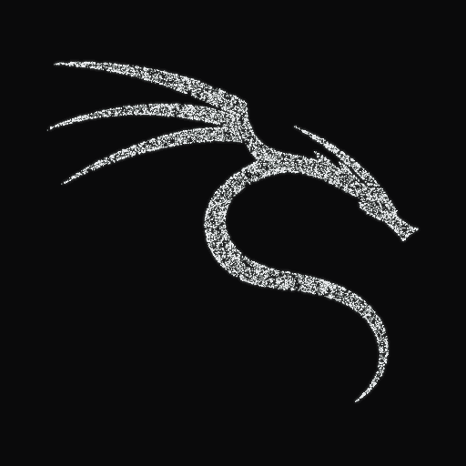
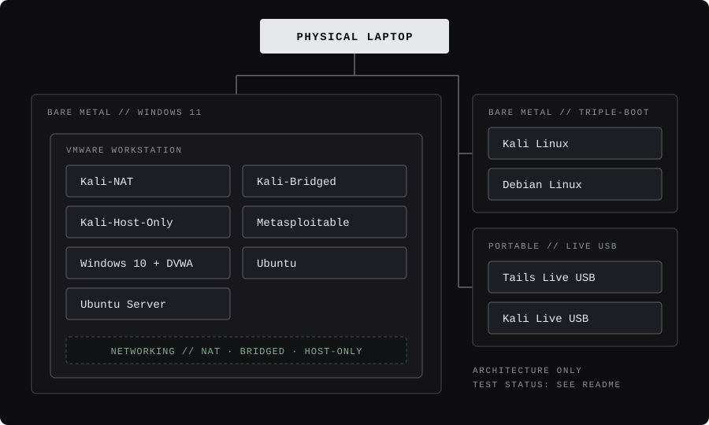

<div align="center">

<table>
<tr>
<td width="420" align="center" valign="middle">



</td>
<td valign="middle" align="left">

# Hi, I'm Muhammad Hussain

**Cybersecurity-focused Computer Science student** working toward penetration testing and application security through a hands-on lab, security tooling, vulnerability assessment and documented practice.

`Web Application Security` · `Penetration Testing` · `Vulnerability Assessment` · `OWASP Top 10` · `Burp Suite` · `OWASP ZAP` · `Nmap` · `Linux` · `Python` · `Bash` · `Docker` · `Security Automation`

</td>
</tr>
</table>

</div>

<br>

```text
$ whoami
muhammad-hussain

$ focus
web-security
application-security
penetration-testing
vulnerability-assessment

$ environment
kali-linux
linux
burp-suite
python
security-labs

$ status
building // testing // documenting
```

---

## Security focus

Direction, not a claim of expertise. I keep these three things separate on purpose.

| | |
| --- | --- |
| **Hands-on now** | Built a Python security scanner for Odoo deployments · operate and document a multi-OS personal cyber lab (infrastructure) · TryHackMe practice · Secure SDLC and application security assessment exposure during a security internship |
| **Developing toward** | Professional penetration testing · application security · authorized security assessments · vulnerability research · bug bounty methodology |
| **Planned** | API security testing · cloud security labs · Active Directory · container / Docker security · CI/CD security · malware analysis · SOC / blue-team exercises · detection engineering |

Primary areas: Web Application Security · Vulnerability Assessment · Penetration Testing · Application Security · Secure SDLC · API Security · Security Automation · Linux Security.

---

## Projects

### Security engineering

#### [Odoo Security Scanner](https://github.com/mhussainx94/odoo-security-scanner) `v2.0`

A vulnerability-assessment tool for Odoo deployments, written in Python with a Flask interface and a CLI.

| | |
| --- | --- |
| **Problem** | A repeatable way to assess an Odoo deployment's exposure and configuration |
| **Tests** | Open ports and services · SSL/TLS · HTTP security headers · cookies · Odoo-specific endpoints · authentication · matching against a bundled CVE database |
| **Produces** | JSON, TXT and HTML reports |
| **Why it matters** | Brings network, transport, HTTP and application-level checks into one tool with machine-readable and human-readable output |

<!-- PENDING: verify every line above against odoo-security-scanner/README.md and source. Capabilities come from my brief, not from the repo. -->

#### [Personal Cybersecurity Lab](https://github.com/mhussainx94/personal-cyber-lab) `Active / Evolving`

A personally operated lab for hands-on learning in web security, network security, vulnerability assessment and penetration testing. It is a real multi-OS architecture, not a list of installed tools.

<div align="center">

</div>

<br>

Windows 11, Kali Linux and Debian are separate operating systems on one triple-boot machine. Tails and Kali run as independent live-boot USB environments. VMware Workstation runs under Windows 11.

**Honest status.** The infrastructure exists. Testing on it has not started.

| Area | Status |
| ---- | ------ |
| Infrastructure | `ACTIVE` |
| Architecture documentation | `ACTIVE` |
| Web security testing (DVWA) | `NOT YET TESTED` |
| Network security testing | `NOT YET TESTED` |
| Vulnerability assessment | `NOT YET TESTED` |
| Penetration testing | `NOT YET TESTED` |
| Security automation | `PLANNED` |

### Security automation and research

#### [VDP-PRO Safe Recon](https://github.com/mhussainx94/vdp-pro-safe-recon)

Authorized, passive reconnaissance and security automation in **Bash**, built around a repeatable workflow and a safe testing methodology. It is a personal workflow project, not an offensive reconnaissance platform.

<!-- PENDING: add concrete behaviour (inputs, outputs, what it does and does not touch) from vdp-pro-safe-recon/README.md and main script. -->

#### [Onion Web Crawler](https://github.com/mhussainx94/onion-web-crawler)

A research and security-tooling project in **Python** that works over **Tor**.

<!-- PENDING: one sentence on the technical purpose (what it crawls, what it records, how) from onion-web-crawler/README.md. -->

### Hands-on security learning

#### [TryHackMe](https://github.com/mhussainx94/TryHackMe)

Documented practical labs and applied learning on security concepts.

<!-- PENDING: name the rooms/paths actually completed, from the TryHackMe repo contents. -->

### Systems and technical projects

#### [CipherLog Assembly](https://github.com/mhussainx94/CipherLog-Assembly)

A lower-level, systems-oriented project written in assembly.

<!-- PENDING: describe what it does from CipherLog-Assembly/README.md (architecture, assembler, purpose). -->

#### [Portfolio](https://github.com/mhussainx94/mhussainx94-portfolio)

Personal portfolio site: [mhussainx94-portfolio.vercel.app](https://mhussainx94-portfolio.vercel.app)

---

## Experience

**Software Security Intern** · National CERT, Pakistan

<!-- PENDING: add dates and location if you want them shown. -->

- Exposure to Secure SDLC practices
- Exposure to application security assessment
- Vulnerability identification and remediation-oriented work
- Security testing methodologies and industry-standard security tools

---

## Security profile

Grouped by domain. Not rated: the evidence is in the projects above.

| Domain | Areas |
| ------ | ----- |
| **Web and application security** | Web Application Security · OWASP Top 10 · VAPT · Secure SDLC · Vulnerability Identification · Remediation |
| **Security testing** | Burp Suite · OWASP ZAP · Nmap · Vulnerability Assessment · Network Scanning · Security Testing Methodologies |
| **Programming and automation** | Python · Bash · SQL |
| **Operating systems** | Kali Linux · Linux · Windows |
| **Networking** | Computer Networking · Network Security · TCP/IP fundamentals · Network Scanning |

<!-- PENDING: Burp Suite, OWASP ZAP, Nmap and SQL come from my brief's example list. Confirm each is something you have actually used before publishing. -->

### Learning path

```text
Linux → Networking → HTTP/HTTPS → Web Applications → Authentication & Authorization
      → Burp Suite → OWASP → Advanced Web Vulnerabilities → API Security → Penetration Testing
```

---

## Certifications

| Certification | Issuer | Issued |
| ------------- | ------ | ------ |
| Google Cybersecurity | Google | Dec 2025 |
| Tools of the Trade: Linux and SQL | Google | Dec 2025 |
| Cybersecurity for Everyone | University of Maryland | Aug 2025 |
| Kali Linux | Coursera / Board Infinity | Jul 2025 |
| CyberSecurity | Asian Development Bank | Jun 2025 |
| Generative AI Essentials | IBM | Aug 2025 |
| Data Analyst | OneRoadmap | May 2025 |

<!-- ISC2 Candidate is deliberately omitted: its listed validity ended July 2026. -->

<!-- PENDING: Education section. The brief was cut off at "National University of Technol...". Send the full degree, institution and dates. -->

---

## Connect

[GitHub](https://github.com/mhussainx94) · [Portfolio](https://mhussainx94-portfolio.vercel.app)

<!-- PENDING: add LinkedIn (and any other link you want) once you send the URL. -->
