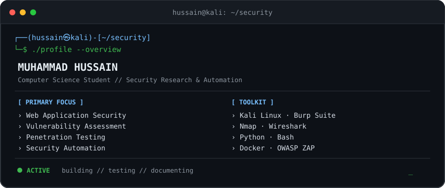
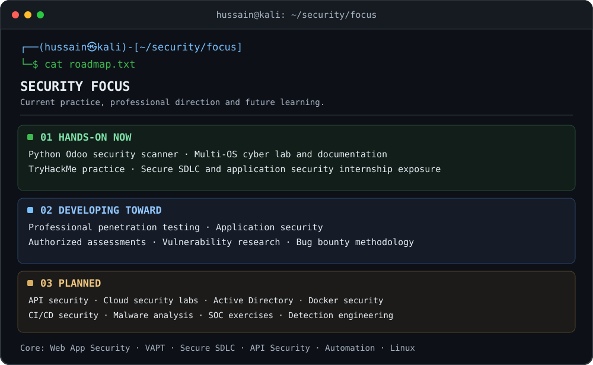
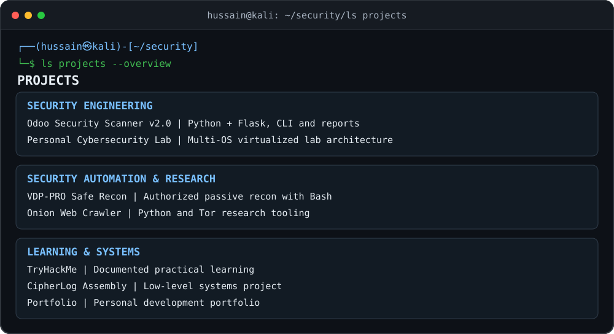
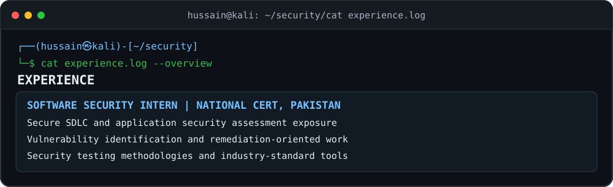
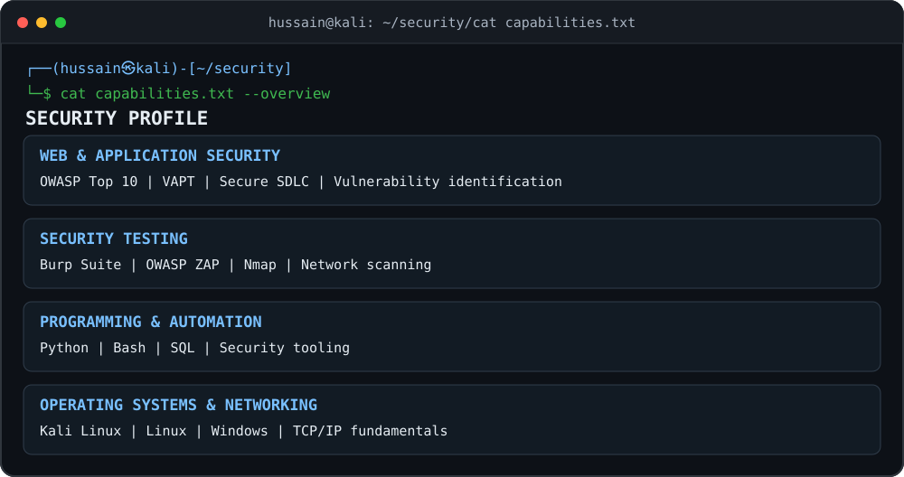
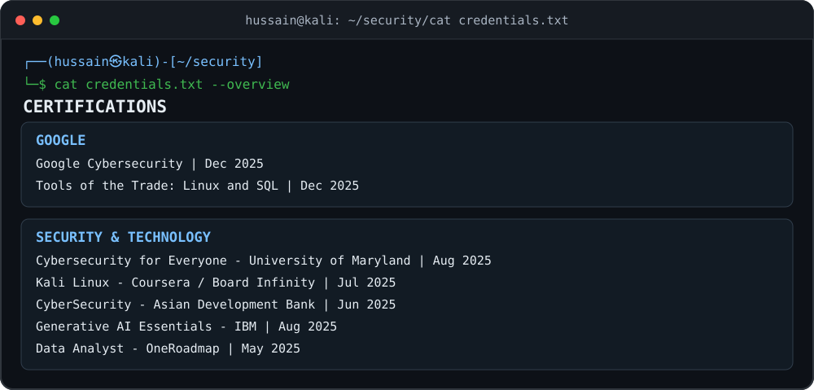
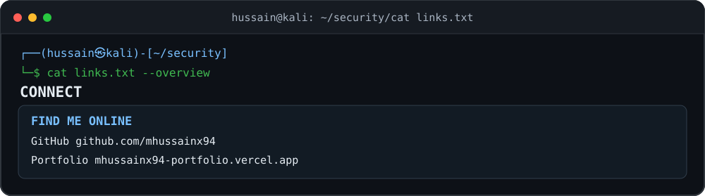

<div align="center">

<table>
<tr>
<td width="420" align="center" valign="middle">


</td>
<td valign="middle" align="left">

# Hi, I'm Muhammad Hussain

**Cybersecurity-focused Computer Science student** working toward penetration testing and application security through a hands-on lab, security tooling, vulnerability assessment and documented practice.

                   

</td>
</tr>
</table>

</div>

<br>

<div align="center">



</div>

---

## Security focus

<div align="center">



</div>

---

## Projects

<div align="center">



</div>

**Explore the repositories:** [Odoo Security Scanner](https://github.com/mhussainx94/odoo-security-scanner) · [Personal Cybersecurity Lab](https://github.com/mhussainx94/personal-cyber-lab) · [VDP-PRO Safe Recon](https://github.com/mhussainx94/vdp-pro-safe-recon) · [Onion Web Crawler](https://github.com/mhussainx94/onion-web-crawler) · [TryHackMe](https://github.com/mhussainx94/TryHackMe) · [CipherLog Assembly](https://github.com/mhussainx94/CipherLog-Assembly) · [Portfolio](https://github.com/mhussainx94/mhussainx94-portfolio)

<details>
<summary><b>Personal Cybersecurity Lab — architecture and current status</b></summary>


Windows 11, Kali Linux and Debian are separate operating systems on one triple-boot machine. Tails and Kali run as independent live-boot USB environments. VMware Workstation runs under Windows 11.

**Documented lab status:** Infrastructure and architecture documentation are active; testing milestones in the original README were marked not yet tested or planned.

</details>

---

## Experience

<div align="center">



</div>

---

## Security profile

<div align="center">



</div>

<details>
<summary><b>Skills and tools — technology badges</b></summary>

### Skills and tools

                 

                   
**Security disciplines:** Web Application Security · Penetration Testing · Vulnerability Assessment · OWASP Top 10 · Application Security · Secure SDLC · Network Security · Security Automation

</details>

### Learning path

```text
Linux → Networking → HTTP/HTTPS → Web Applications → Authentication & Authorization
      → Burp Suite → OWASP → Advanced Web Vulnerabilities → API Security → Penetration Testing
```

---

## Certifications

<div align="center">



</div>

---

## Connect

<div align="center">



</div>

[GitHub](https://github.com/mhussainx94) · [Portfolio](https://mhussainx94-portfolio.vercel.app)
